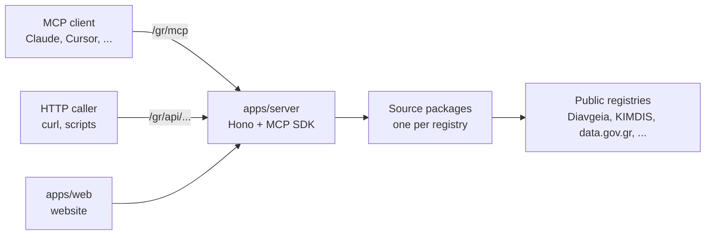

# agoramcp

MCP servers over open government data. Greece is the first country.

Connect Claude, Cursor or any MCP client, then ask the Greek public registries
questions in plain language.

| | |
|---|---|
| Countries | Greece (`gr`) |
| Sources | 13 |
| Tools | 74 |
| Server | https://agoramcp-server.vercel.app |
| Website | https://agoramcp-web.vercel.app |

## How it works



- Each source is one package that knows one upstream registry.
- The server mounts every source. It has no per-source code.
- Every answer carries the upstream licence and attribution.

## Endpoints

| Path | What it is |
|---|---|
| `/gr/mcp` | One MCP server with every Greek source. Tool names have a prefix: `diavgeia_get_decision`. |
| `/gr/mcp/{source}` | One MCP server per source. Plain tool names: `get_decision`. |
| `/gr/api/{source}/{tool}` | The same tools over plain HTTP `GET` or `POST`. |
| `/gr/api` | The country's sources and where each tool answers. |
| `GET /` | Every source and country server, with tools, licence and attribution. |
| `GET /health` | Liveness probe. |

The MCP endpoints use Streamable HTTP.

## Connect

Claude Code:

```bash
claude mcp add --transport http greece https://agoramcp-server.vercel.app/gr/mcp
```

Most other clients take an entry like this one. The exact shape changes per
client; `/quickstart` on the website shows each one.

```json
{
  "mcpServers": {
    "greece": { "type": "http", "url": "https://agoramcp-server.vercel.app/gr/mcp" }
  }
}
```

Plain HTTP, no MCP client:

```bash
curl -G --data-urlencode 'ada=9ΓΓ346ΝΨ2Ν-Β5Τ' \
  https://agoramcp-server.vercel.app/gr/api/diavgeia/get_decision
```

## Sources (Greece)

| Source | What it holds | Tools | Licence |
|---|---|---:|---|
| `admie` | Electricity use, production and forecasts from the grid operator (ADMIE) | 5 | Not stated |
| `athens` | City of Athens open-data portal, 460+ datasets | 7 | Not stated |
| `civilprotection` | Daily wildfire risk forecast for the fire season | 3 | CC BY-NC-SA 4.0 |
| `datagov` | data.gov.gr, the national catalogue, 22,000+ datasets | 7 | Per dataset |
| `diavgeia` | Diavgeia, every published administrative act | 17 | CC BY 4.0 |
| `ecb` | ECB statistics: exchange rates, bond yields, bank rates | 5 | ESCB reuse policy |
| `et` | Government Gazette (FEK): laws, decrees and issues | 4 | Not stated |
| `eurostat` | EU statistics for Greece and its regions | 3 | CC BY 4.0 |
| `fuelprices` | Daily fuel prices per prefecture since 2017 | 4 | Other (Open) |
| `kimdis` | KIMDIS, public contracts from request to payment | 7 | CC BY 4.0 |
| `mitos` | Mitos, the registry of administrative procedures | 7 | CC BY-SA 4.0 |
| `noa` | Earthquake catalogue of the National Observatory of Athens | 3 | CC BY 4.0 |
| `vies` | EU VAT number lookup: AFM to company name | 2 | Not stated |

- One line per tool: [`docs/gr-documentation.md`](docs/gr-documentation.md).
- Full reference: the `DOCUMENTATION.md` in each source package.

## Repository

```
apps/
  server/              MCP server and HTTP API (Hono + MCP SDK)
  web/                 website (Next.js)
packages/
  core/                Source interface, HTTP client, cache, errors, logger
  ckan/                shared tools for any CKAN portal
  sources/{cc}/{id}/   one package per data source
docs/                  tool index per country
```

## Run locally

```bash
pnpm install
pnpm dev          # MCP server on :3000
pnpm dev:web      # website on :3001
pnpm typecheck
pnpm test         # every *.test.ts, offline, in a few seconds
```

List a source's tools with the official inspector:

```bash
npx @modelcontextprotocol/inspector --cli http://localhost:3000/gr/mcp/diavgeia \
  --transport http --method tools/list
```

## Add a source

1. Create `packages/sources/{country}/{id}/` with `src/index.ts`, `tools.ts`, `client.ts` and `meta.ts`.
2. Put the publisher, licence and attribution in `meta.ts`.
3. Write each tool with `defineTool`. Handlers return plain data and throw `AgoraError`s.
4. Export the source with `defineSource`.
5. Add the package to `apps/server/package.json` and import it in `apps/server/src/registry.ts`.
6. List its tools in `docs/{country}-documentation.md` and document them in the package's `DOCUMENTATION.md`.

```ts
// packages/sources/gr/{id}/src/index.ts
export const exampleSource = defineSource({
  id: "example",
  country: "gr",
  meta,   // publisher, licence, attribution, cache TTLs
  tools,  // defineTool({ name, title, description, inputSchema, example, handler })
  probe,  // the cheap call the status monitor makes
});
```

Good examples to copy:

| Upstream | Example |
|---|---|
| A custom API | `packages/sources/gr/mitos` |
| A CKAN portal | `packages/sources/gr/datagov` (uses `packages/ckan`) |

## HTTP API

- `GET` takes the arguments as query parameters. `POST` takes one JSON object.
- A parameter the tool does not declare returns `400`.
- A success returns `{ source, tool, publisher, license, attribution, upstreamUrl, data }`.
- An error returns `{ error: { code, message, retryable } }`.
- The rate limit is 60 calls per minute, per caller, per source. `RateLimit-*` headers show it.

| Error code | Status |
|---|---|
| `invalid_input` | 400 |
| `not_found` | 404 |
| `payload_too_large` | 413 |
| `rate_limited` | 429 |
| `internal` | 500 |
| `upstream_error` | 502 |
| `upstream_unavailable`, `missing_credentials` | 503 |
| `upstream_timeout` | 504 |

## Website

| Page | Purpose |
|---|---|
| `/mcp` | What the MCP server is and how it works |
| `/api` | The HTTP API contract |
| `/quickstart` | Connect a client |
| `/live` | Call tools from the browser |
| `/all` | Every source and tool |
| `/status` | Whether each registry answers, with a 90-day history |
| `/country` | Ask for a new country |
| `/changelog` | What changed, from `apps/web/data/changelog.ts` |

## Database

The website keeps country requests and the status history in Postgres (Neon).
Migrations work like Laravel: `up` and `down` files in
`apps/web/db/migrations/`, plus a `migrations` table.

Run each command as `pnpm --filter @agoramcp/web <command>`.

| Command | What it does |
|---|---|
| `db:status` | Shows what has run |
| `db:migrate` | Runs pending migrations as one batch |
| `db:rollback` | Reverses the last batch (asks first) |
| `db:reset` | Reverses everything (asks first) |
| `db:make <name>` | Creates a new migration file |
| `db:seed [name]` | Runs the seeders, or one of them |

> `apps/web/.env.local` can point at production. Check the database name each
> command prints before you continue.

## Deploy

Two Vercel projects from this repo. Both run in Frankfurt (`fra1`).

| Project | Root directory | Variables |
|---|---|---|
| server | `apps/server` | `VERCEL_EXPERIMENTAL_BACKENDS=1`, `DATABASE_URL`, `REQUEST_HASH_SALT`, `PROXY_SECRET`, `CORS_ORIGINS` |
| web | `apps/web` | `NEXT_PUBLIC_MCP_BASE_URL`, `MCP_SERVER_URL`, `DATABASE_URL`, `REQUEST_HASH_SALT`, `PROXY_SECRET`, `CRON_SECRET` |

- Without `VERCEL_EXPERIMENTAL_BACKENDS=1`, the server builds but fails on every request.
- Use the same `REQUEST_HASH_SALT` and `PROXY_SECRET` on both projects.
- `NEXT_PUBLIC_MCP_BASE_URL` is set at build time. Redeploy `web` when the server URL changes.
- Vercel installs with pnpm 10. Install with the pinned pnpm 11 so that pnpm 10 can read the lockfile.
- The server region is set in the Vercel dashboard. The web region is in `apps/web/vercel.json`.
- The status cron runs once a day. `/status` also starts a check when it is opened.

## Configuration

Each app has its own example file. Copy it next to the app.

| App | Copy | To | Read by |
|---|---|---|---|
| server | `apps/server/.env.example` | `apps/server/.env` | `pnpm dev`, `pnpm start` |
| web | `apps/web/.env.example` | `apps/web/.env.local` | Next.js and the db scripts |

- Every server setting has a default, so the server also runs without its file.
- A variable that is already in the shell wins over the file.
- On Vercel there is no file. Set the variables in the project settings.

| Variable | App | Default | Purpose |
|---|---|---|---|
| `PORT` | server | `3000` | Port for local runs |
| `CORS_ORIGINS` | server | `*` | Origins that can call the server |
| `RATE_LIMIT_PER_MINUTE` | server | `60` | Calls per minute, per caller, per source. `0` turns it off |
| `TOOL_TIMEOUT_MS` | server | `60000` | Longest time one tool call can take |
| `CACHE_MAX_MB` | server | `256` | Size of the in-memory cache |
| `CACHE_MAX_ENTRIES` | server | `5000` | Number of entries in the in-memory cache |
| `LOG_LEVEL` | server | `info` | Log threshold |
| `LOG_TOOL_ARGS` | server | `false` | Logs argument values. For debugging only: `/privacy` says we do not log them |
| `DATABASE_URL` | both | | Postgres. The server writes call records; the web app reads them |
| `DATABASE_URL_UNPOOLED` | web | | Direct connection for migrations and seeders |
| `REQUEST_HASH_SALT` | both | | Salt for the anonymous caller id |
| `PROXY_SECRET` | both | | Proves that a call comes from the website |
| `CRON_SECRET` | web | | Lets the Vercel cron call `/api/cron/status` |
| `NEXT_PUBLIC_MCP_BASE_URL` | web | `http://localhost:3000` | Server URL in the website's snippets |
| `MCP_SERVER_URL` | web | `http://127.0.0.1:3000` | Server URL for the `/live` proxy and the status monitor |

## Licensing

The code is under the GNU Affero General Public License v3.0 only
(`AGPL-3.0-only`). The full text is in [`LICENSE`](LICENSE). Every
`package.json` states the same licence.

Copyright (C) 2026 Apostolos Karamanis.

- You can use, change and share the code.
- If you run a changed version as a network service, you must offer its source
  to the users of that service.

The AGPL covers the code, not the data. The data keeps its upstream licence,
which the [sources table](#sources-greece) shows. Each source declares its
licence and attribution in `meta.ts`. The server sends them in the MCP
instructions, on `GET /`, and with every HTTP API response.
